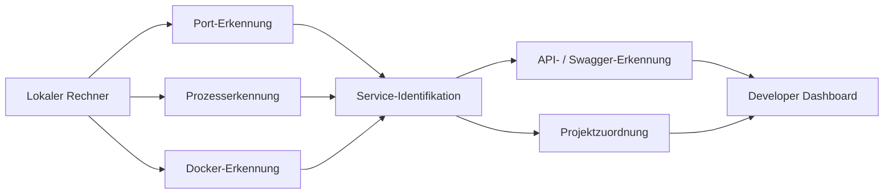

<div align="center">

# LokalHub

### Lokale Entwicklungsumgebung entdecken, verstehen und kontrollieren


<p><a href="./README.md">English</a> · <a href="./README.de.md"><strong>Deutsch</strong></a> · <a href="./README.tr.md">Türkçe</a></p>

<p>
<a href="https://github.com/tahakubilay"></a>
<a href="https://github.com/tahakubilay/LokalHub"></a>


</p>

</div>

---

## ✨ Auf einen Blick

| | |
|---|---|
| 🧭 **Zweck** | Zeigen, was in der lokalen Entwicklungsumgebung läuft |
| 🔌 **Port-Erkennung** | Offene Ports Anwendungen und Services zuordnen |
| ⚙️ **Prozesssichtbarkeit** | Lokale Prozesse hinter aktiven Endpunkten identifizieren |
| 🐳 **Docker-Awareness** | Laufende Container und Servicezustand sichtbar machen |
| 📡 **API-Erkennung** | Bekannte Backend-Endpunkte und API-Dokumentation erkennen |
| 🧩 **Multi-Projekt-Fokus** | Verwirrung bei vielen gleichzeitig laufenden Projekten reduzieren |

> [!NOTE]
> LokalHub ist als **Developer-Productivity- und Observability-Tool** für lokale Umgebungen gedacht. Die finalen Implementierungsdetails werden direkt aus dem fertigen Code dokumentiert.

## 🔎 Überblick

Wenn mehrere Anwendungen gleichzeitig entwickelt werden, wird localhost schnell unübersichtlich.

Man weiß vielleicht, dass

```text
localhost:3000
localhost:3001
localhost:3002
localhost:5000
localhost:8000
...
```

aktiv sind, erinnert sich aber nicht sofort daran:

- Welches Projekt welchem Port gehört
- Welcher Prozess lauscht
- Ob ein Backend gesund ist
- Welcher Docker-Container beteiligt ist
- Ob Swagger / OpenAPI vorhanden ist
- Welches Frontend zu welchem Backend gehört
- Was überhaupt gerade läuft

LokalHub soll diese fragmentierte Umgebung in ein verständliches Dashboard verwandeln.

## ❓ Das Problem

Eine typische lokale Multi-Projekt-Umgebung kann so aussehen:

```text
:3000  → ?
:3001  → ?
:3002  → ?
:5000  → ?
:8000  → ?
Docker → mehrere Container
APIs   → über Projekte verteilt
```

Die Services laufen technisch, aber der Entwickler muss die Zusammenhänge manuell im Kopf behalten.

## 💡 Kernkonzept

```text
Lokale Umgebung scannen
        ↓
Offene Ports erkennen
        ↓
Prozesse / Container auflösen
        ↓
Bekannte Projekte & APIs identifizieren
        ↓
Alles in einem Dashboard darstellen
```

Das Ziel ist einfach:

> **LokalHub öffnen und sofort verstehen, was lokal läuft.**

## 🏗️ High-Level-Architektur



> [!IMPORTANT]
> Discovery-Strategie, Prozessinspektion, Docker-Integration, Plattformunterstützung und API-Erkennung werden aus der finalen Implementierung dokumentiert.

## ⚡ Geplante Sichtbarkeit

| Signal | Was LokalHub zeigen soll |
|---|---|
| 🔌 **Offener Port** | Welcher lokale Endpunkt lauscht |
| 🧠 **Prozess** | Anwendung/Prozess hinter dem Port |
| 📁 **Projekt** | Lesbare Projektidentität, wenn auflösbar |
| 🌐 **Frontend** | Lokaler UI-Endpunkt |
| ⚙️ **Backend** | API-/Service-Endpunkt |
| 📘 **Swagger / OpenAPI** | Dokumentationslink, wenn erkannt |
| 🐳 **Docker** | Containername und Laufzeitstatus |
| ❤️ **Health** | Service-Verfügbarkeit, wenn unterstützt |
| 🔗 **Beziehungen** | Welche Services wahrscheinlich zusammengehören |

## 🖥️ Beispiel für ein Dashboard

| Service | Port | Typ | Status |
|---|---:|---|---|
| Projekt A | 3000 | Frontend | 🟢 Läuft |
| Projekt B | 3001 | Web App | 🟢 Läuft |
| Projekt C API | 5000 | Backend | 🟢 Läuft |
| PostgreSQL | 5432 | Docker / Datenbank | 🟢 Läuft |
| Unbekannter Service | 8080 | Prozess | 🟡 Erkannt |

Dies ist nur illustrativ; die finale Oberfläche richtet sich nach der tatsächlichen Implementierung.

## 🧠 Engineering-Fokus

LokalHub berührt mehrere systemnahe Themen:

- Port- und Socket-Inspektion
- Prozesserkennung
- Lokale Service-Identifikation
- Docker-Integration
- Plattformunterschiede
- API-Metadaten-Erkennung
- Health Checks
- Hintergrund-Scanning
- State-Refresh und Synchronisierung
- Developer-orientierte UX

## 🐳 Docker-Awareness

Docker ist in Multi-Projekt-Umgebungen hilfreich, kann aber eine zusätzliche Sichtbarkeitsschicht erzeugen.

LokalHub soll Containerinformationen in dieselbe lokale Ansicht integrieren, statt ständig zwischen Tools wechseln zu müssen.

Mögliche Informationen:

- Containername
- Runtime-Status
- Exponierte Ports
- Zugehöriges Projekt
- Service-Rolle
- Health-State

## 📡 API- & Dokumentationserkennung

Wo ein Backend erkennbare Metadaten anbietet, kann LokalHub Einstiegspunkte anzeigen:

- API Base URL
- Swagger UI
- OpenAPI-Spezifikation
- Health-Endpunkt
- Development-Server-URL

Die exakten Erkennungsmechanismen werden nach Finalisierung dokumentiert.

## 🖼️ Produktvorschau

| Service Dashboard | Port Mapping | Docker View |
|---|---|---|
| 🖥️ Demnächst | 🔌 Demnächst | 🐳 Demnächst |

## 🚀 Demo

LokalHub ist in erster Linie ein **lokales Developer-Utility**.

Die finale Präsentation wird sich daher eher auf Installation, lokalen Start, eine Beispielumgebung, Screenshots und einen kurzen Walkthrough konzentrieren als auf eine dauerhaft gehostete öffentliche Instanz.

## 🛣️ Projektstatus

- [x] Öffentliches Portfolio-Repository
- [x] Produktpositionierung
- [x] High-Level-Discovery-Architektur
- [ ] Anwendung finalisieren
- [ ] Unterstützte Betriebssysteme dokumentieren
- [ ] Reale Discovery-Mechanismen dokumentieren
- [ ] Screenshots ergänzen
- [ ] Scan-/Refresh-GIF ergänzen
- [ ] Docker-Integration dokumentieren
- [ ] Installationsanleitung ergänzen
- [ ] Beispiel-Projektzuordnungen ergänzen
- [ ] Release-Build veröffentlichen

## 💡 Warum dieses Projekt wichtig ist

LokalHub entstand aus einem praktischen Entwicklungsproblem: **Viele lokale Projekte erzeugen ihre eigene operative Komplexität.**

Statt diese Komplexität hinzunehmen, behandelt das Projekt den Entwicklerrechner selbst als beobachtbares System.

`Developer Tooling` · `System Inspection` · `Local Networking` · `Docker` · `Service Discovery` · `Developer Experience`

---

<div align="center">

### Entwickelt von [Taha Kubilay](https://github.com/tahakubilay)

</div>