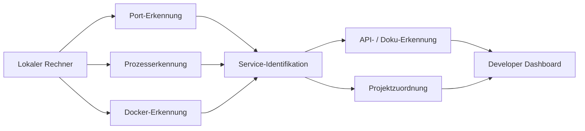

<div align="center">

# LokalHub

### Lokale Entwicklungsumgebung entdecken, verstehen und kontrollieren


<p><a href="./README.md">English</a> · <a href="./README.de.md"><strong>Deutsch</strong></a> · <a href="./README.tr.md">Türkçe</a></p>

<p>
  <a href="https://github.com/tahakubilay"></a>
  <a href="https://github.com/tahakubilay/LokalHub"></a>
  
</p>

</div>

---

## Überblick

LokalHub ist ein Developer-Tool, das sichtbar macht, was in einer lokalen Entwicklungsumgebung läuft.

Wenn mehrere Projekte, APIs, Development-Server und Container gleichzeitig aktiv sind, wird schnell unklar, welcher Prozess zu welchem Port gehört. LokalHub führt diese Informationen in einem Dashboard zusammen.

## Das Problem

Eine lokale Multi-Projekt-Umgebung sieht häufig so aus:

```text
localhost:3000
localhost:3001
localhost:5000
localhost:8000
Docker-Container
Hintergrunddienste
Lokale APIs
```

Die Services funktionieren, aber der Entwickler muss trotzdem beantworten:

- Welches Projekt gehört zu diesem Port?
- Welcher Prozess lauscht?
- Ist der Endpoint Frontend oder Backend?
- Welcher Docker-Container gehört zum Projekt?
- Gibt es API-Dokumentation?
- Welche lokalen Services gehören zusammen?

## Kernmodell



## Sichtbarkeitsbereiche

| Signal | Zweck |
|---|---|
| **Offene Ports** | Aktive lokale Endpunkte sichtbar machen |
| **Prozesse** | Prozesse hinter aktiven Ports identifizieren |
| **Projekte** | Services nach Möglichkeit lesbaren Projektidentitäten zuordnen |
| **Frontend / Backend** | Lokale UI- und API-Endpunkte unterscheiden |
| **Docker** | Container und exponierte Ports sichtbar machen |
| **API-Metadaten** | Nützliche Entwicklungsendpunkte wie API-Dokumentation anzeigen |
| **Health** | Service-Verfügbarkeit darstellen, wenn entsprechende Informationen vorhanden sind |
| **Beziehungen** | Zusammengehörige lokale Services erkennbar machen |

## Engineering-Fokus

LokalHub arbeitet näher an der Betriebssystem- und Entwicklungsumgebung als eine typische Business-Anwendung.

Schwerpunkte:

- Port- und Socket-Inspektion
- Prozesserkennung
- Lokale Service-Identifikation
- Docker-Awareness
- Plattformunterschiede
- API-Metadaten-Erkennung
- Service-Health-Checks
- Hintergrund-Scanning
- State-Refresh und Synchronisierung
- Developer-orientierte UX

## Einsatzbereich

LokalHub ist für lokale Entwicklungsumgebungen gedacht. Der Fokus liegt auf Developer-Transparenz, nicht auf Remote-Infrastruktur-Monitoring oder Production Observability.

---

<div align="center">

### Entwickelt von [Taha Kubilay](https://github.com/tahakubilay)

`Developer Tooling` · `System Inspection` · `Local Networking` · `Docker` · `Service Discovery`

</div>