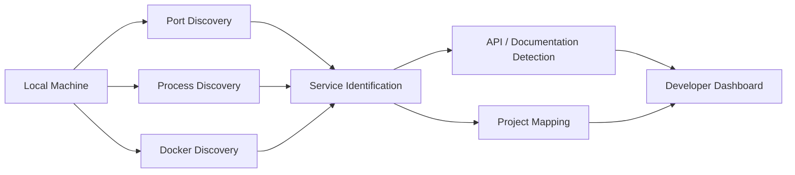

<div align="center">

# LokalHub

### Local developer environment discovery, visibility and control


<p><a href="./README.md"><strong>English</strong></a> · <a href="./README.de.md">Deutsch</a> · <a href="./README.tr.md">Türkçe</a></p>

<p>
  <a href="https://github.com/tahakubilay"></a>
  <a href="https://github.com/tahakubilay/LokalHub"></a>
  
</p>

</div>

---

## Overview

LokalHub is a developer tool for understanding what is running across a local development environment.

When several projects, APIs, development servers and containers are active at the same time, remembering which process owns which port quickly becomes difficult. LokalHub brings that information into one dashboard.

## The Problem

A multi-project local environment often looks like this:

```text
localhost:3000
localhost:3001
localhost:5000
localhost:8000
Docker containers
Background services
Local APIs
```

The services may all be working, but the developer still has to answer:

- Which project owns this port?
- Which process is listening?
- Is this endpoint a frontend or backend?
- Which Docker container belongs to the project?
- Is API documentation available?
- Which local services are related?

## Core Model



## Visibility Areas

| Signal | Purpose |
|---|---|
| **Open Ports** | Show which local endpoints are listening |
| **Processes** | Identify processes behind active ports |
| **Projects** | Associate services with readable project identities where possible |
| **Frontend / Backend** | Distinguish local UI and API endpoints |
| **Docker** | Surface containers and exposed ports |
| **API Metadata** | Expose useful development endpoints such as API docs when detectable |
| **Health** | Present service availability where health information exists |
| **Relationships** | Help identify services that belong to the same local project |

## Engineering Focus

LokalHub sits closer to the operating environment than a typical business application.

Key areas include:

- Port and socket inspection
- Process discovery
- Local service identification
- Docker awareness
- Cross-platform environment differences
- API metadata discovery
- Service health checks
- Background scanning
- State refresh and synchronization
- Developer-focused UX

## Scope

LokalHub is intended for local development environments. It focuses on developer visibility rather than remote infrastructure monitoring or production observability.

## License

LokalHub is licensed under the [MIT License](./LICENSE).

---

<div align="center">

### Built by [Taha Kubilay](https://github.com/tahakubilay)

`Developer Tooling` · `System Inspection` · `Local Networking` · `Docker` · `Service Discovery`

</div>