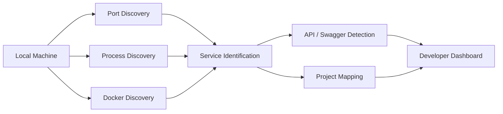

<div align="center">

# LokalHub

### Local developer environment discovery, visibility and control


<p><a href="./README.md"><strong>English</strong></a> · <a href="./README.de.md">Deutsch</a> · <a href="./README.tr.md">Türkçe</a></p>

<br/>

<p>
<a href="https://github.com/tahakubilay"></a>
<a href="https://github.com/tahakubilay/LokalHub"></a>


</p>

<br/>


</div>

---

## ✨ At a Glance

| | |
|---|---|
| 🧭 **Purpose** | Show what is running across a local development environment |
| 🔌 **Port Discovery** | Map open ports to applications and services |
| ⚙️ **Process Visibility** | Identify local processes behind active endpoints |
| 🐳 **Docker Awareness** | Surface running containers and service state |
| 📡 **API Discovery** | Detect known backend endpoints and API documentation where available |
| 🧩 **Multi-Project Focus** | Reduce confusion when many local projects run at the same time |

> [!NOTE]
> LokalHub is designed as a **developer productivity and observability tool** for local environments. The final implementation details will be documented directly from the completed codebase.

## 🧭 Quick Navigation

[Overview](#-overview) • [Problem](#-the-problem) • [Concept](#-core-concept) • [Architecture](#-high-level-architecture) • [Roadmap](#-project-status)

## 🔎 Overview

When multiple applications are being developed at the same time, localhost quickly becomes difficult to reason about.

You may know that:

```text
localhost:3000
localhost:3001
localhost:3002
localhost:5000
localhost:8000
...
```

are active — but not immediately remember:

- Which project owns each port
- Which process is listening
- Whether a backend is healthy
- Which Docker container is involved
- Whether Swagger / OpenAPI exists
- Which frontend belongs to which backend
- What is currently running at all

LokalHub is intended to turn that fragmented environment into one understandable dashboard.

## ❓ The Problem

A typical multi-project local environment might look like this:

```text
:3000  → ?
:3001  → ?
:3002  → ?
:5000  → ?
:8000  → ?
Docker → several containers
APIs   → scattered across projects
```

The services are technically running, but the developer still has to remember the relationships manually.

## 💡 Core Concept

```text
Scan Local Environment
        ↓
Discover Open Ports
        ↓
Resolve Processes / Containers
        ↓
Identify Known Projects & APIs
        ↓
Present Everything in One Dashboard
```

The goal is simple:

> **Open LokalHub and immediately understand your local development environment.**

## 🏗️ High-Level Architecture



> [!IMPORTANT]
> The final discovery strategy, process inspection, Docker integration, platform support and API detection logic will be documented from the finished implementation.

## ⚡ Planned Visibility

| Signal | What LokalHub should show |
|---|---|
| 🔌 **Open Port** | Which local endpoint is listening |
| 🧠 **Process** | The application/process behind the port |
| 📁 **Project** | Friendly project identity where it can be resolved |
| 🌐 **Frontend** | Local UI endpoint |
| ⚙️ **Backend** | API/service endpoint |
| 📘 **Swagger / OpenAPI** | Documentation link where detected |
| 🐳 **Docker** | Container name and runtime state |
| ❤️ **Health** | Service availability / health where supported |
| 🔗 **Relationships** | Which services appear to belong together |

## 🖥️ Example Dashboard Idea

A future dashboard might present information conceptually like:

| Service | Port | Type | Status |
|---|---:|---|---|
| Project A | 3000 | Frontend | 🟢 Running |
| Project B | 3001 | Web App | 🟢 Running |
| Project C API | 5000 | Backend | 🟢 Running |
| PostgreSQL | 5432 | Docker / Database | 🟢 Running |
| Unknown Service | 8080 | Process | 🟡 Detected |

This is illustrative only; the final interface will reflect the actual implementation.

## 🧠 Engineering Focus

LokalHub touches several system-level concerns that are different from ordinary application development:

- Port and socket inspection
- Process discovery
- Local service identification
- Docker integration
- Cross-platform environment differences
- API metadata discovery
- Service health checks
- Background scanning
- State refresh and synchronization
- Developer-focused UX

## 🐳 Docker Awareness

Docker is especially useful in multi-project development environments, but it can also add another layer of visibility problems.

LokalHub is intended to make container information part of the same local view rather than requiring developers to switch constantly between tools.

Potential information includes:

- Container name
- Runtime status
- Exposed ports
- Related project
- Service role
- Health state

## 📡 API & Documentation Discovery

Where a backend exposes recognizable metadata, LokalHub can surface useful developer entry points such as:

- API base URL
- Swagger UI
- OpenAPI specification
- Health endpoint
- Development server URL

Exact detection mechanisms will be documented after the implementation is finalized.

## 🖼️ Product Showcase

| Service Dashboard | Port Mapping | Docker View |
|---|---|---|
| 🖥️ Coming soon | 🔌 Coming soon | 🐳 Coming soon |

The final repository presentation will include real screenshots and a short scanning / discovery GIF.

## 🚀 Demo

Unlike several of the business projects in this portfolio, LokalHub is primarily a **local developer utility**.

The final showcase is therefore likely to focus on:

- Installation
- Local startup
- Example multi-project environment
- Short recorded walkthrough
- Screenshots
- Sample detected services

rather than a permanently hosted public instance.

## 🛣️ Project Status

- [x] Public portfolio repository
- [x] Product positioning
- [x] High-level discovery architecture
- [ ] Finalize application implementation
- [ ] Document supported operating systems
- [ ] Document real discovery mechanisms
- [ ] Add screenshots
- [ ] Add scan / refresh GIF
- [ ] Document Docker integration
- [ ] Add installation guide
- [ ] Add example project mappings
- [ ] Publish release build

## 💡 Why This Project Matters

LokalHub comes from a practical development problem: **running many projects locally creates its own operational complexity.**

Instead of accepting that complexity, this project treats the developer machine itself as a system that can be observed and understood.

It demonstrates work across:

`Developer Tooling` · `System Inspection` · `Local Networking` · `Docker` · `Service Discovery` · `Developer Experience`

---

<div align="center">

### Built by [Taha Kubilay](https://github.com/tahakubilay)

**Software Engineer · Full-Stack Systems · Developer Tooling · Automation**

[⬆ Back to top](#lokalhub)

</div>