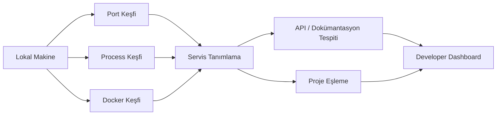

<div align="center">

# LokalHub

### Lokal geliştirme ortamı keşfi, görünürlük ve kontrol


<p><a href="./README.md">English</a> · <a href="./README.de.md">Deutsch</a> · <a href="./README.tr.md"><strong>Türkçe</strong></a></p>

<p>
  <a href="https://github.com/tahakubilay"></a>
  <a href="https://github.com/tahakubilay/LokalHub"></a>
  
</p>

</div>

---

## Genel Bakış

LokalHub, lokal geliştirme ortamında nelerin çalıştığını görünür hale getiren bir developer tool'dur.

Birden fazla proje, API, development server ve container aynı anda çalıştığında hangi process'in hangi porta ait olduğunu takip etmek zorlaşır. LokalHub bu bilgileri tek dashboard altında toplar.

## Problem

Çoklu proje kullanan bir lokal ortam genellikle şöyle görünür:

```text
localhost:3000
localhost:3001
localhost:5000
localhost:8000
Docker container'ları
Background servisler
Lokal API'ler
```

Servisler çalışıyor olsa bile geliştirici hâlâ şu sorulara cevap vermek zorundadır:

- Bu port hangi projeye ait?
- Hangi process dinliyor?
- Bu endpoint frontend mi backend mi?
- Hangi Docker container projeye ait?
- API dokümantasyonu var mı?
- Hangi lokal servisler birbiriyle ilişkili?

## Temel Model



## Görünürlük Alanları

| Sinyal | Amaç |
|---|---|
| **Açık Portlar** | Hangi local endpoint'lerin dinlediğini göstermek |
| **Process'ler** | Aktif portların arkasındaki process'leri tanımlamak |
| **Projeler** | Mümkün olduğunda servisleri okunabilir proje kimlikleriyle eşlemek |
| **Frontend / Backend** | Lokal UI ve API endpoint'lerini ayırmak |
| **Docker** | Container ve exposed port bilgilerini görünür kılmak |
| **API Metadata** | Tespit edilebildiğinde API dokümantasyonu gibi geliştirici endpoint'lerini göstermek |
| **Health** | Uygun bilgi varsa servis erişilebilirliğini göstermek |
| **İlişkiler** | Aynı projeye ait servisleri anlamayı kolaylaştırmak |

## Mühendislik Odağı

LokalHub, klasik bir business uygulamasından daha fazla sistem ve geliştirme ortamı seviyesinde çalışır.

Başlıca konular:

- Port ve socket inceleme
- Process keşfi
- Lokal servis tanımlama
- Docker farkındalığı
- Platform farklılıkları
- API metadata keşfi
- Servis health kontrolleri
- Background scanning
- State refresh ve senkronizasyon
- Developer odaklı UX

## Kapsam

LokalHub lokal geliştirme ortamları için tasarlanmıştır. Remote altyapı izleme veya production observability yerine geliştirici görünürlüğüne odaklanır.

---

<div align="center">

### Geliştiren: [Taha Kubilay](https://github.com/tahakubilay)

`Developer Tooling` · `System Inspection` · `Local Networking` · `Docker` · `Service Discovery`

</div>