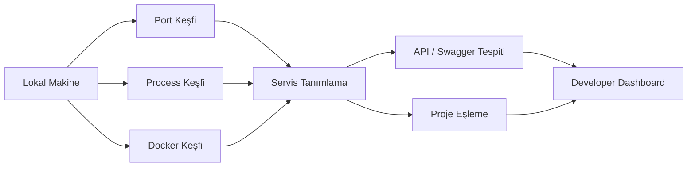

<div align="center">

# LokalHub

### Lokal geliştirme ortamını keşfetme, görünürlük ve kontrol


<p><a href="./README.md">English</a> · <a href="./README.de.md">Deutsch</a> · <a href="./README.tr.md"><strong>Türkçe</strong></a></p>

<p>
<a href="https://github.com/tahakubilay"></a>
<a href="https://github.com/tahakubilay/LokalHub"></a>


</p>

</div>

---

## ✨ Kısaca

| | |
|---|---|
| 🧭 **Amaç** | Lokal geliştirme ortamında neyin çalıştığını göstermek |
| 🔌 **Port Keşfi** | Açık portları uygulama ve servislere eşlemek |
| ⚙️ **Process Görünürlüğü** | Aktif endpoint'lerin arkasındaki local process'leri belirlemek |
| 🐳 **Docker Farkındalığı** | Çalışan container'ları ve servis durumunu göstermek |
| 📡 **API Keşfi** | Bilinen backend endpoint'lerini ve varsa API dokümantasyonunu bulmak |
| 🧩 **Çoklu Proje Odağı** | Aynı anda çalışan çok sayıda projede karmaşayı azaltmak |

> [!NOTE]
> LokalHub, lokal ortamlar için bir **developer productivity ve observability aracı** olarak tasarlanıyor. Final implementasyon detayları tamamlanmış kod tabanından çıkarılarak belgelenecektir.

## 🔎 Genel Bakış

Birden fazla uygulama aynı anda geliştirildiğinde localhost kısa sürede anlaşılması zor hale gelir.

Şunların aktif olduğunu biliyor olabilirsin:

```text
localhost:3000
localhost:3001
localhost:3002
localhost:5000
localhost:8000
...
```

ama hemen hatırlamayabilirsin:

- Hangi port hangi projeye ait
- Hangi process dinliyor
- Backend sağlıklı mı
- Hangi Docker container devrede
- Swagger / OpenAPI var mı
- Hangi frontend hangi backend'e ait
- Genel olarak şu an ne çalışıyor

LokalHub bu parçalı ortamı tek, anlaşılır bir dashboard'a dönüştürmeyi amaçlar.

## ❓ Problem

Tipik bir çoklu-proje lokal ortamı şöyle görünebilir:

```text
:3000  → ?
:3001  → ?
:3002  → ?
:5000  → ?
:8000  → ?
Docker → birden fazla container
APIs   → projelere dağılmış durumda
```

Servisler teknik olarak çalışır, fakat geliştirici ilişkileri zihninde tutmak zorunda kalır.

## 💡 Temel Konsept

```text
Lokal Ortamı Tara
        ↓
Açık Portları Bul
        ↓
Process / Container Eşle
        ↓
Bilinen Projeleri & API'leri Tanı
        ↓
Her Şeyi Tek Dashboard'da Göster
```

Amaç basit:

> **LokalHub'ı aç ve lokal geliştirme ortamını anında anla.**

## 🏗️ Yüksek Seviye Mimari



> [!IMPORTANT]
> Final discovery stratejisi, process inspection, Docker entegrasyonu, platform desteği ve API tespit mantığı bitmiş implementasyondan belgelenecektir.

## ⚡ Planlanan Görünürlük

| Sinyal | LokalHub ne göstermeli |
|---|---|
| 🔌 **Açık Port** | Hangi local endpoint'in dinlediği |
| 🧠 **Process** | Portun arkasındaki uygulama/process |
| 📁 **Proje** | Çözümlenebiliyorsa okunabilir proje kimliği |
| 🌐 **Frontend** | Local UI endpoint'i |
| ⚙️ **Backend** | API/servis endpoint'i |
| 📘 **Swagger / OpenAPI** | Tespit edildiğinde dokümantasyon linki |
| 🐳 **Docker** | Container adı ve runtime durumu |
| ❤️ **Health** | Destekleniyorsa servis sağlık durumu |
| 🔗 **İlişkiler** | Hangi servislerin birbirine ait göründüğü |

## 🖥️ Örnek Dashboard Fikri

| Servis | Port | Tür | Durum |
|---|---:|---|---|
| Proje A | 3000 | Frontend | 🟢 Çalışıyor |
| Proje B | 3001 | Web App | 🟢 Çalışıyor |
| Proje C API | 5000 | Backend | 🟢 Çalışıyor |
| PostgreSQL | 5432 | Docker / Veritabanı | 🟢 Çalışıyor |
| Bilinmeyen Servis | 8080 | Process | 🟡 Tespit edildi |

Bu yalnızca örnektir; final arayüz gerçek implementasyona göre şekillenecektir.

## 🧠 Mühendislik Odağı

LokalHub sıradan uygulama geliştirmeden farklı bazı sistem seviyesi problemlerle ilgilenir:

- Port ve socket inceleme
- Process keşfi
- Local servis tanımlama
- Docker entegrasyonu
- Platformlar arası ortam farklılıkları
- API metadata keşfi
- Servis health check'leri
- Background scanning
- State refresh ve senkronizasyon
- Developer odaklı UX

## 🐳 Docker Farkındalığı

Docker çoklu-proje geliştirme ortamlarında güçlüdür, fakat ayrı bir görünürlük problemi de yaratabilir.

LokalHub container bilgilerini aynı lokal görünümün parçası haline getirerek sürekli araç değiştirme ihtiyacını azaltmayı hedefler.

Olası bilgiler:

- Container adı
- Runtime durumu
- Exposed portlar
- İlgili proje
- Servis rolü
- Health durumu

## 📡 API & Dokümantasyon Keşfi

Backend tanınabilir metadata sunduğunda LokalHub faydalı geliştirici giriş noktalarını gösterebilir:

- API base URL
- Swagger UI
- OpenAPI specification
- Health endpoint
- Development server URL

Kesin tespit mekanizmaları implementasyon finalize edildikten sonra belgelenecektir.

## 🖼️ Ürün Vitrini

| Servis Dashboard | Port Mapping | Docker Görünümü |
|---|---|---|
| 🖥️ Yakında | 🔌 Yakında | 🐳 Yakında |

## 🚀 Demo

LokalHub, bu portföydeki birçok iş yazılımından farklı olarak öncelikle **lokal bir developer utility**'dir.

Bu nedenle final showcase büyük ihtimalle sürekli açık public instance yerine kurulum, lokal başlangıç, örnek çoklu-proje ortamı, ekran görüntüleri ve kısa bir walkthrough üzerine kurulacaktır.

## 🛣️ Proje Durumu

- [x] Public portföy reposu
- [x] Ürün konumlandırması
- [x] Yüksek seviye discovery mimarisi
- [ ] Uygulama implementasyonunu finalize et
- [ ] Desteklenen işletim sistemlerini belgele
- [ ] Gerçek discovery mekanizmalarını belgele
- [ ] Ekran görüntülerini ekle
- [ ] Scan / refresh GIF'i ekle
- [ ] Docker entegrasyonunu belgele
- [ ] Kurulum rehberi ekle
- [ ] Örnek proje eşlemelerini ekle
- [ ] Release build yayınla

## 💡 Bu Proje Neden Önemli?

LokalHub pratik bir geliştirme probleminden doğar: **çok sayıda projeyi lokalde çalıştırmak kendi operasyonel karmaşıklığını yaratır.**

Bu proje bu karmaşıklığı kabul etmek yerine geliştirici makinesinin kendisini gözlemlenebilir ve anlaşılabilir bir sistem olarak ele alır.

`Developer Tooling` · `System Inspection` · `Local Networking` · `Docker` · `Service Discovery` · `Developer Experience`

---

<div align="center">

### Geliştiren: [Taha Kubilay](https://github.com/tahakubilay)

</div>